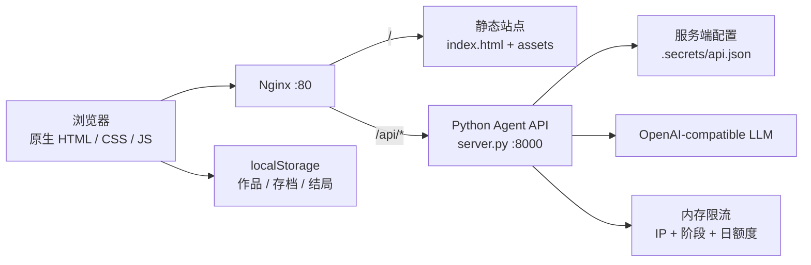
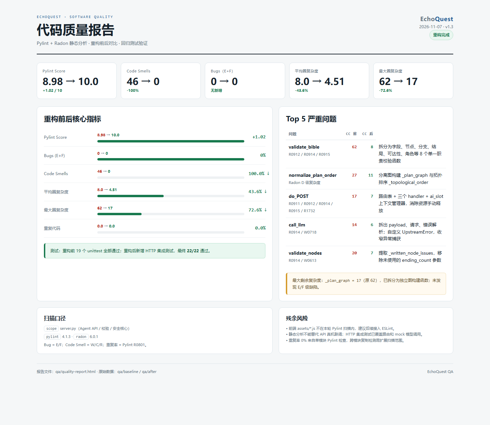

# EchoQuest 回响

> 把一段故事设定，编译成一场可以亲自走进去的互动叙事。

[在线演示](http://120.26.225.51) · [架构设计](docs/software/architecture.md) · [质量报告](qa/quality-report.md) · [部署指南](deploy/README.md)


EchoQuest 是一个 AI 互动叙事创作原型：用户输入一段背景设定，Agent 会先设计专属的故事流程，再逐节点撰写正文，经过结构校验和条件修复后，编译成可以编辑、游玩、存档和多结局探索的文字游戏。

它不是通用聊天机器人，而是一条把自然语言设定生产为可玩互动叙事资产的流水线。

---

## 功能

- **背景驱动生成**：根据故事背景设计专属节点流程，不套用固定“信件 / 灯塔 / 失踪者”模板。
- **动态故事图**：支持 6–16 个节点、2–4 个选项、1 个或 3 个结局。
- **真实 Agent 工作流**：故事架构 → 剧情撰写 → 一致性校验 → 条件修复 → 动态编译。
- **可视化工坊**：故事树预览、逐节点编辑、AI 重写本段、重新生成整局。
- **互动游玩**：角色属性、物品、地点、天气、分支选择、自由行动、剧情回溯。
- **进度系统**：自动存档、5 个手动存档位、结局收集、Markdown 导出。
- **服务端安全代理**：API Key 只存在服务器，浏览器不接触密钥；支持限流、同源校验和失败降级。
- **本地降级**：未配置 API 或上游失败时，自动切换到本地剧情引擎，页面仍然可玩。

---

## 架构



**当前形态：** 静态前端 SPA + Nginx 反向代理 + Python 轻量 BFF + 固定阶段 Agent 流水线 + 浏览器本地存储。

**当前不是：** LangGraph、多 Agent 自主协作、微服务、RAG、服务端作品数据库。

详细模块图、Function Calling Schema 和演进方案见 [架构文档](docs/software/architecture.md)。

### 技术栈

| 层 | 技术 |
|---|---|
| 前端 | 原生 HTML / CSS / JavaScript，Hash 路由，无框架、无构建步骤 |
| 后端 | Python 3.10+ 标准库 `ThreadingHTTPServer` |
| 模型 | OpenAI-compatible Chat Completions API |
| 网关 | Nginx |
| 部署 | systemd + Nginx |
| 数据 | 浏览器 localStorage；服务端仅保存密钥和内存限流 |
| 质量 | Pylint + Radon + unittest |

运行时不依赖第三方 Python 包。

---

## 快速开始

### 1. 准备环境

- Python 3.10 或更高版本
- 可选：Nginx（仅公网部署需要）

```bash
python --version
```

### 2. 配置 Agent

复制示例配置：

```bash
mkdir -p .secrets
cp deploy/api.example.json .secrets/api.json
```

编辑 `.secrets/api.json`：

```json
{
  "provider": "openai-compatible",
  "baseUrl": "https://api.deepseek.com/v1",
  "model": "deepseek-chat",
  "apiKey": "在这里填入你的 API Key"
}
```

> `.secrets/` 已加入 `.gitignore`。不要把真实 Key 提交到 GitHub。

也可以用环境变量覆盖：

```bash
export ECHOQUEST_API_KEY="..."
export ECHOQUEST_BASE_URL="https://api.deepseek.com/v1"
export ECHOQUEST_MODEL="deepseek-chat"
```

Windows PowerShell：

```powershell
$env:ECHOQUEST_API_KEY = "..."
```

### 3. 启动

```bash
python server.py
```

打开：

```text
http://127.0.0.1:8000
```

### 4. 只跑静态前端（无 Agent）

如果只想查看页面和本地剧情引擎：

```bash
python -m http.server 4317 --bind 127.0.0.1
```

打开 `http://127.0.0.1:4317`。没有 `/api` 时页面会自动使用本地生成器。

---

## Agent 工作流

```text
用户背景
  → 故事架构 Agent（LLM，生成动态节点图）
  → 本地结构校验
  → 剧情撰写 Agent（LLM，按节点写正文）
  → 一致性校验（节点、选项、结局、文本）
  → 条件修复 Agent（有 issues 时）
  → 动态故事树编译
  → 工坊 / 游玩
```

生成页会显示阶段、耗时、token 消耗和 Agent 轨迹。API 不可用时会降级到 `assets/story-generator.js`。

---

## 项目结构

```text
.
├── index.html                    页面外壳
├── server.py                     静态服务 + Agent API 代理 + 限流
├── assets/
│   ├── styles.css                视觉系统与响应式布局
│   ├── data.js                   示例故事与基础模板
│   ├── story-generator.js        本地设定解析与降级生成器
│   ├── agent.js                  前端 Agent 编排、动态编译、Trace
│   ├── app.js                    路由、创作、工坊、游玩、存档
│   └── cover-*.svg               本地封面插画
├── deploy/
│   ├── api.example.json          API 配置模板
│   ├── echoquest.service         systemd 服务
│   ├── nginx-echoquest.conf      Nginx 配置
│   └── README.md                 公网部署指南
├── docs/
│   ├── assets/                   README 截图
│   ├── usage.md               用户操作说明
│   └── software/
│       └── architecture.md       架构设计、工具 Schema、安全方案
├── requirements/                 原始产品与需求文档
├── qa/
│   ├── baseline/                 重构前扫描数据
│   ├── after/                    重构后扫描数据
│   ├── screenshots/              扫描与质量报告截图
│   ├── tests/                    单元测试 + HTTP 集成测试
│   ├── quality-report.md         代码质量报告
│   ├── run_scan.py               Pylint + Radon 扫描脚本
│   └── README.md                 QA 使用说明
├── .pylintrc
├── .gitignore
└── README.md
```

`requirements/` 是产品文档目录，不是 pip 依赖；运行时没有第三方 Python 依赖。

---

## 配置项

| 环境变量 | 默认值 | 说明 |
|---|---|---|
| `ECHOQUEST_HOST` | `127.0.0.1` | 监听地址；生产环境只监听本机，由 Nginx 对外 |
| `ECHOQUEST_PORT` | `8000` | Agent 服务端口 |
| `ECHOQUEST_API_KEY` | 空 | 覆盖 `.secrets/api.json` 中的 Key |
| `ECHOQUEST_BASE_URL` | `https://api.deepseek.com/v1` | OpenAI-compatible 接口根地址 |
| `ECHOQUEST_MODEL` | `deepseek-chat` | 模型名 |
| `ECHOQUEST_RATE_LIMIT` | `8` | 每个 IP 每个 Agent 阶段每小时调用上限 |
| `ECHOQUEST_DAILY_LIMIT` | `300` | 全站每日模型调用上限 |
| `ECHOQUEST_ALLOWED_HOSTS` | 空 | 额外允许的 Origin Host，逗号分隔 |

配置优先级：环境变量 > `.secrets/api.json` > 默认值。

---

## 公网部署

完整步骤见 [deploy/README.md](deploy/README.md)。核心结构：

```text
Nginx :80
  ├── /          → /var/www/echoquest 静态文件
  └── /api/*     → 127.0.0.1:8000（systemd 运行的 server.py）
```

生产环境要求：

- API Key 放在服务器 `/opt/echoquest/.secrets/api.json`，权限 `600`，属主 `www-data`。
- Nginx 禁止访问 `.secrets` 等隐藏路径。
- 安全组只开放需要的端口（80/443）。
- 生产环境应补充 HTTPS、备份、日志轮转和监控。

---

## 测试与代码质量

### 运行测试

```bash
python -m unittest discover -s qa/tests -v
```

覆盖：

- JSON 提取与容错
- 拓扑排序与环检测
- 蓝图校验：起点、反向边、不可达节点、结局数量
- 正文校验：节点缺失、选项数量、空文本
- HTTP 路由、健康检查、同源拒绝

### 运行静态分析

```bash
python -m pip install -r qa/requirements-qa.txt --target .qa-tools
python qa/run_scan.py baseline
python qa/run_scan.py after
```

当前结果（详见 [质量报告](qa/quality-report.md)）：

| 指标 | 重构前 | 重构后 |
|---|---:|---:|
| Pylint Score | 8.98 | **10.00** |
| Bugs（E/F） | 0 | 0 |
| Code Smells | 46 | **0** |
| 平均圈复杂度 | 8.0 | **4.51** |
| 最大圈复杂度 | 62 | **17** |
| 重复率 | 0.0% | 0.0% |
| 测试 | 19 | **22 / 22 通过** |



---

## 安全说明

- 不要提交 `.secrets/api.json`、私钥、服务器密码。
- 浏览器永远不直接调用模型 API；密钥只由 `server.py` 读取。
- 服务端校验请求体大小、Origin、IP 限流、日额度和并发数。
- Nginx 拒绝 `.secrets` 等隐藏路径。
- 前端输出使用 HTML 转义，模型 JSON 不执行 `eval`。
- 如果 Key 曾经进入 Git 历史，立即在模型平台轮换，而不是只删除文件。

---

## 已知边界

- 作品、存档和结局保存在当前浏览器 `localStorage`；跨设备分享尚未实现。
- 没有账号系统、服务端作品库、管理后台和付费体系。
- 自由行动续写目前使用本地关键词逻辑，不是逐轮模型调用。
- 没有完整内容审核中台；公网运营前需要补充审核、举报和未成年人保护方案。
- 当前没有 RAG、长期记忆和向量数据库。
- 前端 `assets/*.js` 尚未纳入 ESLint；当前质量扫描范围是 `server.py`。

这些边界和后续演进方案在 [架构文档](docs/software/architecture.md) 中有详细说明。

---

## 发布到 GitHub

```bash
git init
git add .
git commit -m "feat: EchoQuest interactive story agent v1.3"
git branch -M main
git remote add origin https://github.com/<your-name>/<your-repo>.git
git push -u origin main
```

提交前确认：

```bash
git status --short
git check-ignore -v .secrets/api.json
```

`.secrets/`、`.qa-tools/`、`logs/`、本地部署目录和生成的压缩包都不会进入仓库。

---

## License

暂未指定开源许可证。公开发布前请根据使用场景补充 `LICENSE` 文件。
