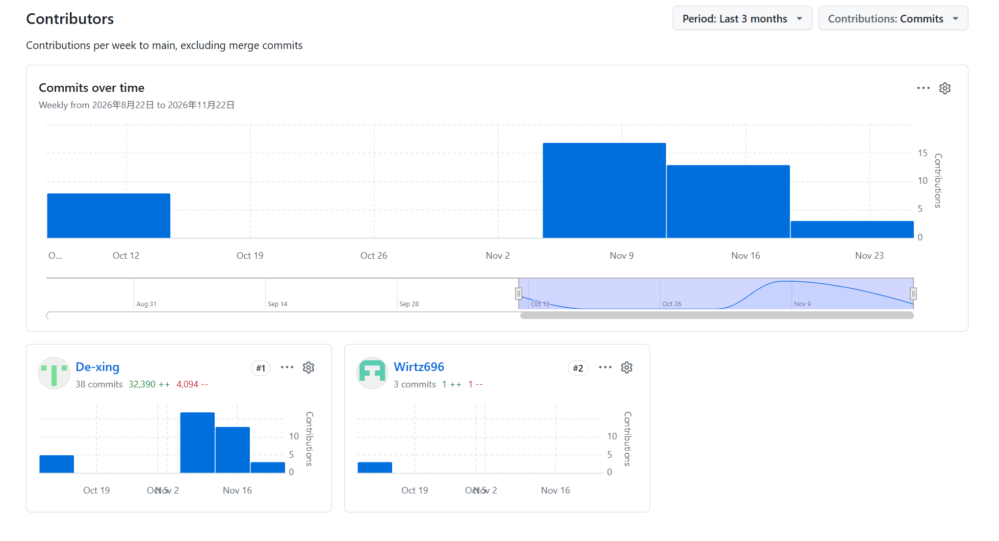

# 答辩幻灯片（Slidev）

EchoQuest 回响项目的答辩材料，用 [Slidev](https://sli.dev) 写成：正文是 Markdown，改内容就是改文本，进 git 可 review、可 diff。

- **正文**：`slides.md`（63 页，按「主讲 / 快翻 / 不讲」三档使用，见第 3 节）
- **素材**：`images/`（截图放这里）
- **发布**：`.github/workflows/deploy-slides.yml` 每次 push 自动构建，产物发到 GitHub Pages

---

## 1. 本地预览

需要 Node.js 18+（推荐 20）。

```bash
cd docs/slides
npm install          # 首次会生成 package-lock.json，请一并提交
npm run dev          # 打开 http://localhost:3030
```

演示者模式：浏览器里按 `p` 打开演讲者视图，可以看到每页的备注（Markdown 里 `<!-- -->` 注释就是备注），以及计时器。

构建产物（用于检查线上效果）：

```bash
npm run build -- --base /ai-text-adventure-game/
npx serve dist       # 或 python -m http.server --directory dist 8000
```

> `--base` 必须与最终访问路径一致；本地随便看可以省略。

导出 PDF（现场没网时用，需要额外装 Playwright）：

```bash
npm i -D playwright-chromium
npx playwright install chromium
npm run export-pdf   # 生成 slides.pdf
```

---

## 2. 部署到 GitHub Pages（三步）

1. 把 `docs/slides/`、`docs/slides/package.json`、`.github/workflows/deploy-slides.yml` 提交并 push 到 `main`。
2. 仓库 **Settings → Pages → Build and deployment → Source** 选择 **GitHub Actions**（只做一次）。
3. 打开 **Actions** 标签看 `Deploy Slides` 运行；成功后访问：

```
https://de-xing.github.io/ai-text-adventure-game/
```

### ⚠️ 一个需要你先决定的事

这个仓库目前 `has_pages = true`，Pages 很可能已经在托管游戏页面（根目录 `index.html`）。**一旦把 Pages 的 Source 切成 GitHub Actions，站点就由这份幻灯片接管**，原游戏页面不再对外提供。

三个选择：

| 选择 | 做法 | 适合 |
|:--|:--|:--|
| **A（推荐）** | 接受覆盖。演示时本机跑 `python server.py`（答辩第二部分本来就要求本机运行） | 想用最短路径拿到一个可点开的幻灯片链接 |
| **B** | 幻灯片放独立仓库（如 `ai-text-adventure-game-slides`），复制本目录 + workflow 过去 | 想同时保留线上游戏页 |
| **C** | 保留当前 Pages 源，幻灯片只在本地/PDF 演示 | 不想动线上资产 |

选 B 时记得把 workflow 里的 `--base` 自动取值逻辑保留（它按仓库名生成），无需改动。

---

## 3. 8 分钟主讲路径

正片 53 页，**不需要全讲**。建议：

| 梯度 | 页码 | 页数 | 每页时间 |
|:--|:--|--:|--:|
| **主讲** | 1–3、5、8、9、11、20、23、25、27–29、31、32、34、35、38、41、43、44、48 | 22 | ~20s |
| **快翻**（一句话带过） | 14–17 原则、21 选型理由、22 仓库、26 基础设施、30 状态机、33 Schema、36–37 记忆细节、40 护栏③、42 知识库来源、45 冲突消解、46 模型对比、47 评估、49–53 数据库/接口/前端/质量/统计 | 21 | 3–5s |
| **不讲** | 54–63 演示、问答、总结、附录 | 10 | — |

主讲路线的一句话逻辑：

> 我们不是聊天机器人（3）→ 谁在用、凭什么赢（5、8）→ 产品定义与用户故事（9、11）→ 选型克制（20）→ 生命周期踩过的坑（23）→ 架构（25）→ **智能体五件套：总览（27）→ 为什么先结构后文本（28）→ 编排（29、31）→ 工具（32、34）→ 记忆（35）→ 护栏（38）→ 知识库（41）→ RAG/KG/记忆如何协作（43、44）→ 能力边界（48）** → 演示（55）

3.5.3 智能体部分占 4 分钟左右，是评分表里点名要求的内容，**不要压缩**。

---

## 4. 改内容去哪里找

| 想改什么 | 位置 |
|:--|:--|
| 封面标题、副标题 | 文件开头（`.cover` 那一块） |
| 产品使命 / 口号 / 用户画像 | `## 1.1`、`## 1.1.3` 开头的段落 |
| 竞品对比表 | `## 1.1.6 如何做到差异化` 的表格 |
| 技术选型表格 | `## 3.2 技术选型` |
| 智能体章节 | `## 3.5.3` 起，连续 16 页，标题都以「任务编排 / 工具调用 / 记忆 / 护栏 / 专业知识库 / 协作」开头 |
| 数据库表清单 | `## 3.5.4` |
| 质量数字 | `## 3.6`（Pylint / Radon 前后对比） |
| 问答页 | `## 预设问题 ①–④`、`⑤–⑧` |
| 参考文献 | 附录 A |
| 全局样式（字号、配色、流程盒） | 文件顶部 `<style>` 块 |

改了数字记得同步 README 与 `docs/software/architecture.md`，三处不一致是答辩现场最容易被抓的点。

---

## 5. 三处截图占位

幻灯片里有 3 个虚线框需要换成真实截图：

| 页码 | 内容 | 来源 |
|:--|:--|:--|
| 22 | 仓库 Pulse 提交历史 + Projects 看板 | `github.com/De-xing/ai-text-adventure-game/pulse` |
| 52 | 质量报告 / 扫描前后对比 | `qa/screenshots/quality-report.png`、`qa/scan-before.html`、`qa/scan-after.html` |
| 53 | 代码统计（文件数、行数、AI 占比） | VS Code Counter 或 JetBrains Statistic 插件导出 |

替换方法：

```md
<!-- 把这一行 -->
<div class="ph" style="height:96px">截图占位：仓库 Pulse 页</div>
<!-- 换成 -->

```

图片放进 `docs/slides/images/`，随提交一起上仓库。**不要用外链图床**——现场断网就白屏。

---

## 6. 常见问题

**打开是白屏 / 样式全丢**
`--base` 与访问路径不一致。项目页必须是 `/<仓库名>/`，用户主页仓库（`xxx.github.io`）才是 `/`。workflow 里已自动判断。

**`npm ci` 报错**
仓库里没有 `package-lock.json`。首次 `npm install` 后把它提交上去；或者不管它——workflow 已做兼容：有 lock 用 `ci`，没有就 `install`。

**Pages 显示 404**
Settings → Pages 的 Source 还停在 “Deploy from a branch”。必须切成 **GitHub Actions**。

**build 报 Node 版本不够**
`node-version: 20` 已在 workflow 里固定；本地若低于 18 请升级。

**中文渲染成方框 / 字重很奇怪**
Slidev 默认主题走系统字体。如果要统一，可在 `slides.md` 顶部 frontmatter 加：

```yaml
fonts:
  sans: 'Noto Sans SC'
  provider: google
```

构建时会自动下载字体（需要网络）。

**B 站/PDF 里图表错位**
本套用纯 HTML + CSS 画流程图（`.dflow` / `.dbox`），不依赖 mermaid，导出 PDF 时是稳定的。若要改用 mermaid，需要额外依赖。

---

## 7. 文件清单

```
docs/slides/
├── README.md          # 本文件
├── slides.md          # 幻灯片正文（全部内容都在这里）
├── package.json       # Slidev 依赖与脚本
├── .gitignore         # 忽略 node_modules / dist
└── images/            # 截图与素材（gitkeep 占位）
.github/workflows/
├── deploy-slides.yml  # 构建 + 发布到 Pages
└── tests.yml          # 修正后的回归测试（原文件放错目录，从未执行）
```
