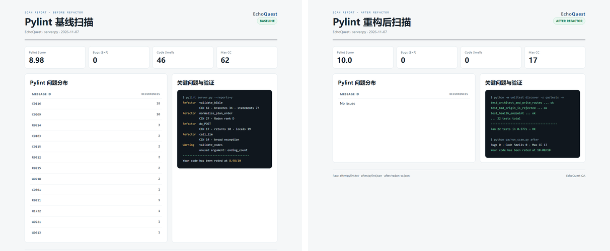

创新工程实践营 · 项目汇报

# EchoQuest 回响

把一段故事设定，编译成一场可以亲自走进去的互动叙事

AI 互动叙事生成 Agent · v1.3

在线演示 http://echoquest.120.26.225.51.sslip.io ｜ 仓库 github.com/De-xing/ai-text-adventure-game

<!--
开场：
"我们不做聊天机器人，我们做一条把故事设定编译成可玩互动叙事的流水线。"
-->

---

## 汇报路线

<b>第一部分 · 产品介绍（8 分钟）</b> 1 产品设计 → 2 设计原则 → 3 产品实现 其中 3.5.3 智能体设计为重点，约 4 分钟

<b>第二部分 · 作品演示（2 分钟）</b> 创作 → 生成 → 编辑 → 游玩

<b>第三部分 · 评委问答（5 分钟）</b> 已准备核心问题与边界回答

<b>附录（不讲）</b> 参考文献、能力边界、演进路线

---

## 一句话价值

# 让有故事想法但不会写代码的人，在几分钟内拿到一个能玩的分支故事

<b>6–16</b> 动态故事节点

<b>2–3 次</b> 单篇模型调用

<b>1 或 3</b> 可校验结局

<b>10–2000 字</b> 输入门槛

不是聊天记录，而是可编辑、可存档的<b>叙事资产</b>：故事图 + 角色属性 + 结局集合。

---

## 1.1.1 使命 ｜ 1.1.2 口号 ｜ 策略

<b>使命</b> 把叙事创作中「结构」这件最费力的体力活交给程序，把「想讲什么」还给创作者。

<b>口号</b> 写一段设定，走进你自己的故事。 Set a world. Walk into it.

<b>策略一 · 先结构后文本</b> 先产出可校验的故事图，再填正文。

<b>策略二 · 收敛自由度</b> 节点/选项/结局/属性都有边界，校验可穷举。

<b>策略三 · 失败可降级</b> 模型失败不白屏，切本地引擎继续玩。

---

## 1.1.3 目标用户

| 画像 | 特征 | 真实诉求 | 使用频次 |
|:--|:--|:--|:--|
| 独立创作者 | 有设定和点子，不会写代码 | 5 分钟内验证设定值不值得继续写 | 每周 2–3 次 |
| 校园写作社团 | 分组共创，老师要能点评结构 | 一节课产出多版对比，看得见分支差异 | 每学期集中 |
| 同人二创作者 | 已有角色卡与世界观，怕 OOC | 角色设定锁死，AI 只填场景 | 高频 |
| 展会 / 品牌互动 | 扫码即玩，5 分钟一个短篇 | 高并发、可控成本、统一调性 | 项目制 |

首个种子用户群：本校写作社与游戏社；早期做了 3 次共 11 人的非正式访谈。

---

## 1.1.4 如何获得用户 ｜ 1.1.5 团队优势

<b>获客路径（低成本三角）</b> 
① <b>社团共创</b>：给写作社做「30 分钟生成 10 个开场」工作坊，作品页即展示页； 
② <b>作品可见性</b>：导出 Markdown、分享链接，创作即传播； 
③ <b>题材挑战赛</b>：每周一个题目，用同一主题的不同故事图做对比传播。

<b>团队优势</b> 
① <b>叙事理解</b>：成员是 TRPG / 互动小说玩家，知道什么叫「选项有代价」； 
② <b>工程质量</b>：Pylint 10.00、22 个 unittest、7 条用户路径； 
③ <b>克制的技术观</b>：项目初期标准库 + 原生前端，不引入框架债； 
④ <b>可替换性</b>：模型只改 baseUrl / model / apiKey 三项。

---

## 1.1.6 差异化：我们卖的不是“生成”

| 维度 | 通用对话模型 | AI Dungeon 类 | Twine / Ink | EchoQuest |
|:--|:--|:--|:--|:--|
| 产出物 | 聊天记录 | 无限续写文本 | 手工树 | **可玩故事图（资产）** |
| 结构保证 | 无 | 弱 | 强但靠手写 | **程序校验 + 条件修复** |
| 分支/结局 | 无 | 弱 | 有 | **6–16 节点 / 1 或 3 结局** |
| 用户门槛 | 会提问 | 会打字 | 会写脚本 | **写 10–2000 字背景** |
| 单篇成本 | 按 token 累积 | 高（长上下文） | 0 | **2–3 次短调用** |
| 失败兜底 | 无 | 无 | 不适用 | **本地引擎降级不白屏** |

<b>一句话：</b>别人卖「生成」，我们卖「生成之后一定玩得下去」。

---

## 1.2 产品定义

对于 <b>有故事创意但不会写代码的独立创作者与校园写作社团</b> 
他们 <b>想把脑内设定快速变成可玩的分支故事，判断值不值得继续写</b> 
EchoQuest <b>是一个把自然语言设定编译成可玩互动叙事的生成式 Web 应用</b> 
它能够 <b>在几分钟内产出 6–16 节点、带属性与多结局、可逐节点编辑的故事，并立即试玩</b> 
不同于 <b>通用对话模型（只有文本、没有结构）和传统创作工具（结构全靠手工）</b> 
我们的产品 <b>用「架构 → 校验 → 撰写 → 修复 → 编译」的流水线，保证结构可玩、成本可观测、失败可降级</b>

---

## 1.2.1 解决的问题

<b>① 结构不可玩</b> 模型边写边迷路：分支断链、结局不可达、选项数量飘。 对策：先图后文 + 拓扑校验 + 条件修复

<b>② 产出不可复用</b> 聊天记录无法编辑、存档、版本化，改一句要整篇重来。 对策：编译成节点/选项，支持节点级重写

<b>③ 成本与延迟不可控</b> 一次超长提示词，贵、慢、失败即全废。 对策：2–3 次短调用 + 只重跑失败阶段 + 降级

三条来自早期用户访谈：大家抱怨的不是“模型不聪明”，而是“生成出来的东西玩不下去”。

---

## 1.2.2 用户故事

<b>US-1｜社团展示。</b>作为一个写作社学生，我想把「雨夜图书馆」这个开场变成 5 分钟能玩的分支短篇，以便在社团活动上快速展示三种不同走向。

<b>US-2｜数值验证。</b>作为一个独立游戏爱好者，我想把角色放进有体力、线索、信任三个属性的世界，以便验证这套数值是否真的让人“有取舍”。

<b>US-3｜结构点评。</b>作为一个社团指导老师，我想看到每次生成的结构问题清单，以便判断学生讲的故事“通不通”，而不是只看文笔。

三个故事的共同点：价值落在“拿到一个能用的结构”，不是“读了一段好文字”。

---

## 1.2.3 解决方案形态：Web 应用

<b>形态</b> 浏览器 SPA + 服务端 API 代理 index.html + assets，无构建步骤

<b>为什么不是 App</b> App 上架审核、多端适配和分发成本高；Web 更适合快速验证核心体验

<b>为什么不是小程序</b> 内容审核与未成年人保护要求更重，先用 Web 跑通内容链路

<b>形态服务目标：</b>扫码/发链接即玩；零安装；老师课堂可本地起一份副本。

---

## 2. 产品设计原则总览

<b>需求</b> 真实需求 &gt; 想象需求，需求要分层

<b>信息</b> 一屏一信息，进度必须可见

<b>创新</b> 换的不是界面，是抽象层次

<b>系统</b> 分层，每层只做一件事

<b>收敛</b> 把自由度换成枚举

<b>优化</b> 先结构后文本，局部重跑

<b>继承</b> 复用协议与基础设施，不重造

<b>效益</b> 每次调用都要换来可验收的产物

<b>时间</b> 先跑通再优化，三周 MVP

<b>定量</b> 通过率/断链率/延迟/成本可测

<b>简化</b> 无框架、无运行时第三方依赖

<b>审核</b> 结构校验 + 内容审核 + 人工抽检

---

## 2.1 需求 · 信息 · 创新原则

| 原则 | 在本产品中的做法 | 证据 |
|:--|:--|:--|
| 真实需求 | 只做访谈中出现≥2 次的诉求；砍掉多人协作、角色语音 | 早期 11 人访谈，砍掉 4 个功能 |
| 需求分层 | Must：能生成能玩；Should：可编辑；Nice：分享 | 三周 MVP 只做 Must + Should |
| 信息原则 | 生成过程显示阶段、耗时、token、Agent 轨迹 | 生成页固定展示 4 项 |
| 创新原则 | 从“生成文章”换成“编译故事图” | 产物是图，不是文本 |
| 创新有边界 | 不做多 Agent 自治，先保证可验收 | 能力边界页主动说明 |

<b>总结：</b>创新点不在“用了大模型”，而在“把大模型放进一个有断言的编译器里”。

---

## 2.2 系统 · 收敛 · 优化原则

<b>系统原则</b> 四层：浏览器 → Nginx → Agent 服务 → 模型。 模型只生成内容，边界由程序守

<b>收敛原则</b> 节点 6–16、选项 2–4、结局 1 或 3、属性 3 个。 自由度收敛 → 校验可穷举

<b>优化原则</b> 先定图再写文；校验失败只重跑修复，不整篇重生成。 失败阶段可单独定位

<b>反例反思：</b>最初版本让模型边规划边写正文，18 个节点里 4 个断链、2 个结局不可达、单篇约 11 万 token。改成两段式后，结构问题在写正文前被拦下，单篇降到 2–3 次短调用。

---

## 2.3 继承 · 效益 · 时间 · 定量 · 简化 · 审核

<b>继承</b> OpenAI-compatible 协议、JSON Schema、Nginx + systemd；换模型不改编排。

<b>效益</b> 每次模型调用必须换来可验收产物：架构→图、撰写→正文、修复→合格 JSON。

<b>时间</b> 三周 MVP：第 1 周链路，第 2 周工坊与游玩，第 3 周质量与部署。

<b>定量</b> JSON 一次通过率、断链率、P95 延迟、单篇 token；Trace 明细已接入，报表按阶段汇总。

<b>简化</b> 前端无框架无构建，后端标准库；运行时零第三方依赖。

<b>审核</b> 结构校验自动化；内容审核中台未完成，公网运营前必须补。

---

## 3.1 用户体验设计考虑的因素

<b>首屏零步进入</b> 首页直接放示例作品，点开就能玩。

<b>等待感可见</b> 阶段条 + 耗时 + token + Agent 轨迹。

<b>失败不白屏</b> 模型失败自动切本地引擎。

<b>一切可逆</b> 节点编辑、整局重生成、存档、回溯。

早期试用里，7/11 人在“没有任何反馈的 20 秒等待”中退出过页面，所以“等待感可见”优先级最高。

<figure class="shot">
  
  <figcaption>首页：示例作品 + 零注册进入</figcaption>
</figure>

---

## 3.2 技术选型（含版本）

| 条目 | 内容 | 版本 | 备注 |
|:--|:--|:--|:--|
| 前端语言 | JavaScript (ES2022) | — | 原生，无构建 |
| 后端语言 | Python | 3.10+（实测 3.13.5） | 运行时零第三方依赖 |
| Web 服务 | `http.server.ThreadingHTTPServer` | stdlib | 轻量 BFF |
| 模型 | `deepseek-chat` | 2026-11 配置 | OpenAI-compatible |
| 网关 | Nginx | 1.18+ | 静态站点 + `/api` 反代 |
| 进程管理 | systemd | — | 自启、崩溃重启 |
| 数据 | 浏览器 localStorage | — | 本地零运维；生产版可切换关系库 |
| 质量 | Pylint / Radon / unittest | 4.1.3 / 6.0.1 / stdlib | 22 个用例 |
| CI | GitHub Actions | — | 回归测试 |
| 幻灯片 | Slidev | latest | Markdown 即源码 |

IDE：VS Code；不锁定小版本。完整表格见仓库 README。

---

## 3.2 技术选型理由：不要太重，也不要太轻

<b>为什么“轻”</b> 
① 选型验证的是叙事结构，不是框架能力； 
② 单机 3 并发、每天 300 次调用的量级，标准库足够； 
③ 零依赖 = 老师/评委在自己电脑上 `python server.py` 就能跑。

<b>什么时候必须“重”</b> 
① 并发 &gt; 50 或多实例：换 FastAPI + Gunicorn； 
② 账号/作品库/审核：PostgreSQL + Redis； 
③ 语义检索：pgvector。 
三条写进架构文档 §7.4 的分阶段路线。

<b>选型标准：</b>这项技术是否解决当前阶段的唯一瓶颈？当前瓶颈是“模型输出不可控”，所以重心放在校验与编排，不是框架。

---

## 3.3 代码仓库与协作

<b>仓库</b> <code>github.com/De-xing/ai-text-adventure-game</code> JavaScript + Python · Web 应用

<b>提交规范</b> Conventional Commits：<code>feat:</code> / <code>fix:</code> / <code>docs:</code> / <code>refactor:</code> 每条提交对应一个可验收改动

<b>提交历史</b> <a href="https://github.com/De-xing/ai-text-adventure-game/pulse">github.com/De-xing/ai-text-adventure-game/pulse</a> 按功能拆分提交，每个提交对应一个可验收改动

<b>CI / Issues</b> GitHub Actions 跑 22 个 unittest Issues 作为公开缺陷池；质量报告见 3.6

<b>协作问题修正：</b>原 <code>workflows/tests.yml</code> 放错目录，导致 Actions 实际没执行；已迁移到 <code>.github/workflows/</code>。

---

## 3.4 全生命周期主要问题与解决

| 阶段 | 问题 | 发生原因 | 解决办法 |
|:--|:--|:--|:--|
| 分析 | “AI 生成故事”不可验收 | 缺可量化标准 | 定义一次通过率/断链率/P95/token |
| 设计 | 想直接上多 Agent 自治 | 高估收益、低估调试成本 | 收敛为固定阶段流水线 |
| 开发 | 模型 JSON 带围栏、尾逗号 | 模型不受 Schema 约束 | `extract_json` 容错 + 校验 + 一次 repair |
| 重构 | 单文件越写越乱，最大复杂度 62 | 职责混杂 | 拆分职责，Pylint 8.98→10.00 |
| 测试 | 单测依赖真实 API，不稳定 | 未打桩 | fixtures + mock LLM，22 用例 |
| 部署 | Key 有进仓库风险 | 配置写代码里 | `.secrets` 600 + Nginx 拒隐藏路径 |
| 运维 | CI 文件放错目录，实际没跑 | 不熟悉 Actions 约定 | 迁到 `.github/workflows/` |

---

## 3.5.0 使用工具

<b>设计与架构</b> Mermaid（关系/流程草图） Slidev HTML 组件（架构图、流程条） 不依赖外链图床

<b>开发与调试</b> VS Code / 浏览器 DevTools Python 3.13.5 Nginx + systemd（部署）

<b>质量与协作</b> Pylint 4.1.3 + Radon 6.0.1 unittest + Playwright（QA） Git / GitHub Actions

图都尽量用仓库内的文本/HTML 重绘，不用 PPT 截图；这样改版本时不会出现“图和代码对不上”。

---

## 3.5.1 系统架构图

<b>浏览器 SPA</b>原生 HTML/CSS/JS Hash 路由

──▶

<b>Nginx :80</b>静态资源 /api 反代

──▶

<b>Agent 服务</b>server.py :8000 同源/限流/编排

──▶

<b>LLM</b>OpenAI-compatible deepseek-chat

<b>localStorage</b>作品·存档·结局

◀──

<b>浏览器</b>与上图同一端

──▶

<b>本地剧情引擎</b>降级兜底

│

<b>.secrets/api.json</b>600 · 仅服务端读

<b>分层职责</b> 浏览器：交互与本地数据 服务：同源/限流/编排/校验 模型：只生成内容

<b>关键约束</b> 浏览器不接触 Key 模型输出不直接改状态

<b>降级路径</b> 上游失败 → 本地引擎 可用性优先

3.5.0 制图工具：Mermaid（架构草稿）+ Slidev HTML 组件；图片均为本地素材，不依赖外链。

---

## 3.5.2 基础设施图

<b>用户</b>浏览器 / 扫码

──▶

<b>阿里云 ECS</b>单台 · 公网 80

──▶

<b>Nginx</b>/var/www/echoquest

──▶

<b>systemd</b>echoquest.service 127.0.0.1:8000

| 项 | 当前现状 | 扩展方向 |
|:--|:--|:--|
| 计算 | 单台 ECS，3 并发 | 弹性与多实例 |
| 存储 | 浏览器 localStorage | 作品持久化与备份 |
| 密钥 | `/opt/echoquest/.secrets/api.json`，600 | 轮换流程与 KMS |
| 网络 | 80 端口，安全组最小开放 | HTTPS + WAF |
| 可观测 | 日志 + 前端 Agent Trace | requestId 贯通 + 成本看板 |

基础设施按单机演示规模设计；生产化按表中的扩展方向推进。

---

## 3.5.3 智能体设计 · 总览

核心判断：<b>模型只负责“写”，程序负责“准不准、能不能玩、贵不贵”。</b>

| 部件 | 当前实际 | 演进/设计 |
|:--|:--|:--|
| 任务编排 | 生成期固定流水线，游玩期规则推进 | Plan-and-Solve、图规划 |
| 工具调用 | 3 个固定 HTTP 阶段 + 本地校验/编译 | Function Calling 白名单 |
| 记忆 | 故事圣经 + localStorage | Redis + PostgreSQL + pgvector |
| 护栏 | 同源/限流/48KB/HTML 转义/注入隔离 | 审核服务 + PII 脱敏 |
| 知识库 | 提示词中的故事圣经与硬约束 | RAG + 故事知识图谱 |

采用确定性编排：生成期可复现、可校验；工具、记忆、知识库均保留可替换扩展位，按阶段接入。

---

## 3.5.3 为什么不是一次性长提示词

<b>最初做法</b> 
所有要求写进一段 system prompt，让模型一次吐出完整故事 JSON。  
实测失败：18 节点里 4 个断链；2 个结局不可达；选项在 2–6 之间飘；单篇约 11 万 token，失败全废。

<b>改成两段式</b> 
模型只产出图（拓扑 + 故事圣经）→ 程序校验 → 模型按图填正文。  
收益：结构问题在写正文前拦下；校验器可单测；失败只重跑修复；成本变成 2–3 次短调用。

<b>根因：</b>模型不能同时解“结构应该长什么样”和“这段文字怎么写”，约束越靠后越容易丢。

---

## 3.5.3 生成流水线

<b>① 架构</b>/architect

▶

<b>② 结构校验</b>拓扑/选项/结局

▶

<b>③ 撰写</b>/write

▶

<b>④ 一致性校验</b>节点/文本/可达

▶

<b>⑤ 条件修复</b>/repair

▶

<b>⑥ 编译</b>图→game

| 阶段 | 能否跳过模型 | 失败后的动作 |
|:--|:--:|:--|
| 架构 | 否 | 超时重试 1 次 → 降级 |
| 结构校验 | **是** | 生成 issues，进入修复 |
| 撰写 | 否 | 重试/降级 |
| 条件修复 | 否 | 最多 2 次总调用 |
| 编译 | **是** | 复用已有内容重跑 |

失败路径：超时、429/5xx、JSON 解析失败、断链/选项不足、输出截断；每条都有明确归宿，不静默返回半成品。

---

## 3.5.3 工具边界与护栏

<b>模型能做什么</b> 只产出 JSON 内容；没有数据库、文件系统、网络权限；不能直接改服务端状态。 当前是固定阶段接口，不是模型自主 Function Calling。

<b>程序必须做什么</b> 结构校验、选项过滤、结局可达、编译、错误信封、限流、密钥隔离。 改结构/改状态/放行内容的动作，一律由程序执行。

<b>输入</b> 10–2000 字 HTML/控制字符处理 注入模式检查

<b>权限</b> 工具白名单 无 DB/FS/网络 状态变更过编译器

<b>输出</b> 只收 JSON 字段/长度限制 HTML 转义，不 eval

<b>数据</b> Key 服务端 600 同源校验 48KB + 限流

---

## 3.5.3 记忆与知识：实现与扩展

<b>本地实现</b> 
作品、存档、结局、草稿在 localStorage；每次生成携带故事圣经；上下文只包含当前任务需要的内容；以最小状态闭环支撑完整体验。

<b>扩展架构</b> 
会话记忆（Redis TTL）、单局工作记忆（run steps）、长时记忆（摘要 + 向量）；固定预算装配，超长按优先级裁剪。

<b>硬约束</b> 世界观/角色底线，全量注入，不交给检索层。

<b>RAG</b> 场景/摘要 topK=3–5；作为扩展检索层接入。

<b>知识图谱</b> 角色/地点/伏笔关系；按需接入图查询。

<b>为什么分三层：</b>读写频率、体积、过期策略不同；混在一起会为了记住一句设定，把整局对话都塞进上下文。

---

## 3.5.3 协作架构：硬约束 / 图 / RAG / 记忆

| 组件 | 回答什么问题 | 数据 | 当前状态 |
|:--|:--|:--|:--|
| 硬约束 | 什么绝对不能被改写？ | 角色底线、世界规则 | 故事圣经全量注入 |
| 故事图 | 谁和谁是什么关系？这条路径通不通？ | 节点、选项、角色、地点 | 节点图已编译 |
| RAG | 哪段已写内容与当前场景最相关？ | 场景/摘要 + embedding | 扩展检索层 |
| 工作记忆 | 这一局玩家做了什么？ | 当前节点、属性、选择 | localStorage |

<b>装配顺序：</b>硬约束（全量）→ 当前/相邻节点 → 最近交互 → 图邻域 → RAG topK → 旧摘要。冲突时按这个优先级裁决，不交给模型自由决定。

本版本以硬约束 + 当前节点 + 工作记忆为主；图查询与 RAG 作为扩展层，按同一装配顺序接入。

---

## 3.5.4 数据设计：本地存储与生产扩展

<b>本地存储（零运维）</b> 
<code>echoquest.userGames.v1</code> 作品 
<code>echoquest.saves.v1</code> 手动存档 
<code>echoquest.autosave.v1</code> 自动存档 
<code>echoquest.endings.v1</code> 结局 
<code>echoquest.draft.v1</code> 草稿

<b>生产化关系模型</b> 
users / games / story_nodes / choices 
runs / run_steps / run_saves 
generation_tasks / pipeline_issues / audit_logs
 用于账号、跨设备作品库和生产审计；本地版不依赖数据库即可运行。

E-R 关系：game 1–N story_nodes；story_node 1–N choices；run 1–N run_steps；game 1–N run_saves。迁移路径是把 localStorage 的键映射为可跨设备查询的表。

---

## 3.5.5 接口设计

| 接口 | 功能 | 输入 | 输出 |
|:--|:--|:--|:--|
| `GET /api/health` | 健康检查 | — | `ok, ai, model, provider` |
| `POST /api/agent/architect` | 生成故事蓝图 | background, genre, tone, length, endingCount | blueprint, issues, usage |
| `POST /api/agent/write` | 按图写正文 | bible, background, endingCount | nodes{}, issues, usage |
| `POST /api/agent/repair` | 按 issues 修复 | bible, nodes, issues | nodes{}, issues |

<b>统一响应：</b>成功 `{ok:true, data, meta}`；失败 `{ok:false, error, code}`。内容审核与记忆检索按同一包络预留扩展接口，契约与实现同步维护。

---

## 3.5.6 前端设计

<b>技术形态</b> 原生 HTML/CSS/JS Hash 路由 无框架、无构建

<b>模块划分</b> <code>app.js</code> 路由/业务 <code>agent.js</code> Agent 编排/编译 <code>story-generator.js</code> 降级 <code>data.js</code> 示例/模板

<b>安全渲染</b> 统一 <code>escapeHtml</code> 不把模型输出拼进属性 不 <code>eval</code>

<b>状态管理</b> localStorage 分键 每键版本化

<b>可观测</b> 前端 Agent Trace：阶段/耗时/token/失败原因

<b>响应式</b> 单列优先、底部操作区、点击区 ≥44px

<b>为什么不用 Vue/React：</b>4 个视图、状态集中、无多人协作；页面数翻倍或需要协同编辑时立刻换。

---

## 3.6 软件质量

<b>重构前后（Pylint + Radon）</b> 

Pylint Score：<b>8.98 → 10.00</b> 
Code Smells：<b>46 → 0</b> 
平均圈复杂度：<b>8.0 → 4.51</b> 
最大圈复杂度：<b>62 → 17</b> 
测试：<b>22 / 22 通过</b>

<b>3.6.1 质量控制 ｜ 3.6.2 质量工具</b> 

① 日志：阶段、耗时、token、错误码，不记密钥/正文 
② 异常：超时/限流/解析/断链/截断都有归宿 
③ Pylint：语义与风格检查；Radon：圈复杂度 
④ 测试：单元 + HTTP 集成 + 同源拒绝 
⑤ CI：GitHub Actions 跑回归

<figure class="shot">
  
  <figcaption>质量报告：Pylint 分数、Code Smell、复杂度</figcaption>
</figure>
<figure class="shot">
  
  <figcaption>左：重构前 8.98 / 46 smells；右：重构后 10.00 / 0</figcaption>
</figure>

扫描脚本在仓库 <code>qa/</code>，可现场复跑：<code>python qa/run_scan.py after</code>。

---

## 3.7 代码统计

<b>规模（当前仓库实测）</b> 

后端：<code>server.py</code> 899 行 / 36.9 KB 
前端：<code>app.js</code> 3,108 行 / 152 KB；<code>styles.css</code> 116 KB；<code>agent.js</code> 410 行 / 19 KB；<code>story-generator.js</code> 49 KB 
测试：2 个测试文件 / 22 个用例 
存储：localStorage（零运维）

<b>模块数</b> 
前端 5 个 JS 模块 + 1 个样式表；后端 1 个服务模块；测试 2 个目录（unit/integration）；生产化 schema 在架构设计中单独维护。

<b>文档与交付物</b> 架构文档 39 KB；测试用例 50 KB；质量报告 8 KB；部署指南 20 KB

<b>AI 辅助 vs 手写</b> 骨架与重复性代码由 AI 辅助；校验器、状态机、Schema、提示词策略由团队设计与修改。 按文件归属粗估约 60% AI 辅助 / 40% 人工设计与修改；非行级精确统计。

---

## 第二部分 · 作品演示（2 分钟）

| 时间 | 动作 | 让评委看到什么 |
|:--|:--|:--|
| 0:00 | 首页点示例作品 | 零注册，首屏即玩 |
| 0:20 | 回创作页，输入 30 字背景 | 门槛就是一段话 |
| 0:30 | 点生成，指阶段条 | 架构→校验→撰写→编译，含耗时/token |
| 1:00 | 工坊改一个节点 | 产物是结构，可局部改 |
| 1:20 | 游玩走两条分支 | 选项有代价，状态常驻 |
| 1:45 | 展示结局/存档/导出 | 叙事资产可保存、可带走 |

<b>兜底：</b>网络/额度异常时直接演示本地降级引擎——页面仍可生成可玩故事，这不是事故，是设计点。

---

## 三句话总结

<b>产品</b> 不是聊天机器人，是把设定编译成可玩叙事的流水线。

<b>技术</b> 模型只管写，程序管边界：编排、校验、降级、限流。

<b>工程</b> Pylint 10.00 · 22 用例 · 成本与失败路径可观测 · 边界写清楚。

谢谢 · 欢迎提问

demo http://echoquest.120.26.225.51.sslip.io ｜ code github.com/De-xing/ai-text-adventure-game

---

## 附录 · 参考文献与工具

<b>方法：</b>ReAct（arXiv:2210.03629）、Plan-and-Solve（arXiv:2305.04091）、Self-Refine（arXiv:2303.17651）、GraphRAG（arXiv:2404.16130）、Lost in the Middle（arXiv:2307.03172）、MemGPT（arXiv:2310.08560）  
<b>工程：</b>OpenAI-compatible Chat Completions、JSON Schema 2020-12、Nginx、systemd、Pylint、Radon、unittest、Playwright  
<b>本幻灯片：</b>Slidev；正文即 Markdown，可进 Git、可 review、可 diff。

版本定位：可运行 Web 应用。作品持久化、账号、RAG 与审核按生产化路线独立推进；本版本聚焦创作、校验、编辑与游玩的完整闭环。

